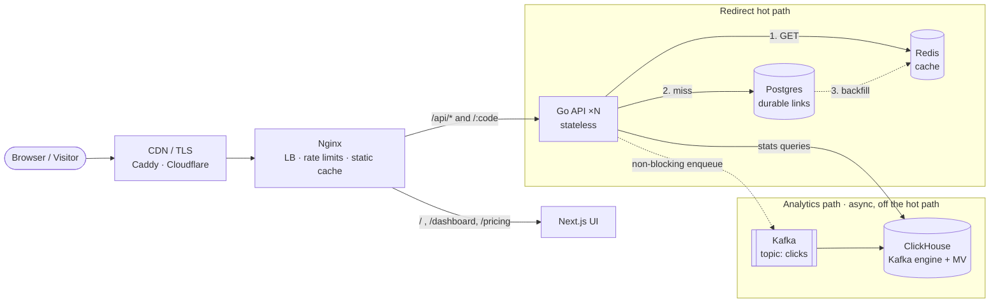

# Zipli

A production-style URL shortener built for **high throughput and low latency**. Redirects are served from Redis; click analytics travel on a separate asynchronous lane (Kafka → ClickHouse) so tracking can never slow a redirect down.

- **Instant redirects**: Redis read-through cache in front of Postgres, with negative caching and request coalescing.
- **Never blocks a click**: the redirect handler only does a non-blocking channel send. If Kafka is down, redirects keep working and events are retried with backoff.
- **Real analytics**: clicks, unique visitors, referrers, countries, devices, browsers and operating systems, per link and per account.
- **Guest shortening**: paste a URL on the home page, no account needed (7-day links, rate limited).
- **Accounts**: email + password, JWT, per-plan link limits, custom aliases, expiry, enable/disable, QR codes.
- **Stateless API**: scale by adding replicas.
- **Animated UI** built on shadcn/ui components (Next.js / React / Tailwind / framer-motion).
- **One command to run**: everything is Dockerized.

---

## Architecture



**A redirect** (`GET /:code`): Nginx → Go API → Redis `GET`. On a miss the API reads Postgres once (concurrent misses for the same code are coalesced with `singleflight`) and backfills Redis. The API responds `302` and drops a click event on an in-memory buffered channel. That is all the request does.

**A click event** is enriched on a background worker (user-agent parsing, hashed visitor id, referrer host), batched, and written to Kafka. ClickHouse consumes the topic through its Kafka table engine and a materialized view into a MergeTree table. The dashboard queries ClickHouse.

**Why `302`, not `301`**: browsers cache `301`s and would skip future hits, so clicks would go uncounted.

**Why Nginx does not cache redirects**: a cached redirect never reaches the API, so the click would never be recorded. Redis already makes the lookup fast. Nginx only caches static assets.

### Failure behaviour

| What fails | What happens |
|---|---|
| Kafka down | Redirects unaffected. The producer retries batches with backoff (up to 10 min) while events queue in a 20k buffer; overflow is dropped and counted (`/healthz` → `events_dropped`). Verified: zero loss across a 60 s outage. |
| ClickHouse down | Redirects unaffected. Kafka retains events (72 h by default) and ClickHouse catches up on restart. Stats endpoints return 502. |
| Redis down | The cache layer degrades to Postgres on every request (slower, still correct). |
| One API replica down | Nginx retries the other replica. |

---

## Tech stack

| Layer | Technology |
|---|---|
| API | Go 1.26, chi, pgx, go-redis, kafka-go |
| Durable storage | PostgreSQL 17 |
| Cache | Redis 7 (LRU, no persistence) |
| Event bus | Apache Kafka 3.9 (KRaft, no ZooKeeper) |
| Analytics store | ClickHouse 24.8 |
| Edge | Nginx 1.27 (load balancing, rate limiting, static cache) · Caddy (production TLS) |
| UI | Next.js 16, React 19, Tailwind 4, **shadcn/ui** (Radix), framer-motion, Sonner toasts, lucide icons |
| Packaging | Docker Compose |

---

## Quick start

Requirements: Docker with Compose v2. Nothing else is needed (Go and Node run inside containers).

```bash
cp .env.example .env        # then edit the secrets
docker compose up -d --build
```

First start takes a few minutes (image pulls and builds). When `docker compose ps` shows everything running, open **http://localhost:8088**.

| URL | What |
|---|---|
| http://localhost:8088 | Landing page with the guest shortener |
| http://localhost:8088/register | Create an account |
| http://localhost:8088/dashboard | Manage links and see analytics |
| http://localhost:8088/pricing | Plans (BDT) |
| http://localhost:8088/readyz | Readiness (Postgres + Redis) |
| http://localhost:8088/healthz | Liveness + Kafka event counters |

Stop with `docker compose down`. Add `-v` to also delete all data.

### Local test accounts (development only)

These exist only in the local database of the machine where they were created. Create your own on `/register`, or use:

| Email | Password |
|---|---|
| `t@example.com` | `password123` |
| `ui-test@example.com` | `LocalTest-4821` |

Never reuse these anywhere real.

### Try the API

```bash
B=http://localhost:8088

# Guest link, no account
curl -s -X POST $B/api/links/public -H 'content-type: application/json' \
  -d '{"url":"https://example.com/some/long/path"}'

# Account flow
TOKEN=$(curl -s -X POST $B/api/auth/register -H 'content-type: application/json' \
  -d '{"email":"me@example.com","password":"a-long-password"}' | sed -E 's/.*"token":"([^"]+)".*/\1/')

curl -s -X POST $B/api/links -H "authorization: Bearer $TOKEN" -H 'content-type: application/json' \
  -d '{"url":"https://example.com","alias":"demo"}'

curl -i $B/demo                                                     # 302 → https://example.com
curl -s "$B/api/links/demo/stats?days=7" -H "authorization: Bearer $TOKEN"
```

---

## API reference

All bodies are JSON. Authenticated routes need `Authorization: Bearer <token>`. Errors are `{"error": "..."}`.

| Method & path | Auth | Description |
|---|---|---|
| `GET /{code}` | – | Redirect (`302`) to the target; `404` if unknown, expired or disabled |
| `POST /api/links/public` | – | Guest shorten `{url}`. 7-day expiry, no alias, no stats. Limited to 10 req/min per IP |
| `POST /api/auth/register` | – | `{email, password}` (password 8–72 chars) → `{token, user}` |
| `POST /api/auth/login` | – | `{email, password}` → `{token, user}` |
| `GET /api/me` | ✔ | Current user, plan link limit and analytics `retention_days` |
| `POST /api/links` | ✔ | `{url, alias?, expires_at?}` (RFC 3339). `402` when the plan limit is reached, `409` if the alias is taken |
| `GET /api/links?limit=&offset=` | ✔ | Your links, newest first |
| `PATCH /api/links/{code}` | ✔ | `{disabled: bool}` |
| `DELETE /api/links/{code}` | ✔ | Delete a link (also evicts it from Redis) |
| `GET /api/links/{code}/stats?days=7` | ✔ | Clicks, uniques, daily series, top referrers/countries/devices/browsers/OS. `days` is clamped to the plan's history (Free 7, Pro 90, Business/Enterprise 365); the response includes `retention_days` |
| `GET /api/stats/overview?days=30` | ✔ | Account-wide totals, daily series, per-link click counts |
| `GET /healthz`, `GET /readyz` | – | Liveness / readiness |

Aliases are 3–32 characters of `[A-Za-z0-9_-]`; words used by the web UI (`api`, `login`, `register`, `dashboard`, `pricing`, …) are reserved. Links to this service's own host are rejected to prevent redirect loops.

---

## Configuration

Compose reads `.env` (see `.env.example`). The API container receives these variables:

| Variable | Default | Purpose |
|---|---|---|
| `DATABASE_URL` | – (required) | Postgres connection string |
| `REDIS_ADDR` | `localhost:6379` | Redis `host:port` |
| `KAFKA_BROKERS` | `localhost:9092` | Comma-separated brokers |
| `KAFKA_TOPIC` | `clicks` | Click event topic |
| `CLICKHOUSE_URL` / `_USER` / `_PASSWORD` / `_DB` | `http://localhost:8123` / `default` / – / `shorturl` | Analytics queries (HTTP) |
| `JWT_SECRET` | – (required, ≥16 chars) | Signs login tokens |
| `IP_SALT` | `change-me` | Salt for the hashed visitor id (raw IPs are never stored) |
| `GOOGLE_CLIENT_ID` / `GOOGLE_CLIENT_SECRET` | empty (button shows "not set up") | Enables **Continue with Google** (see below) |
| `BASE_URL` | `http://localhost:8088` | Public origin used to build short links |
| `CACHE_TTL_SECONDS` | `86400` | Max Redis TTL for a link (expiring links use their expiry) |
| `HTTP_ADDR` | `:8080` | Listen address |

Compose-level variables: `POSTGRES_PASSWORD`, `CLICKHOUSE_PASSWORD`, `HTTP_PORT` (host port, default `8088`), and for production `DOMAIN`.

### Plans and limits

Both are enforced in the API (`api/internal/server/server.go`): link limits (`planLimits`: Free 25, Pro 1,000, Business 10,000, Enterprise unlimited) and analytics history (`planRetention`: Free 7 days, Pro 90, Business/Enterprise 365; ClickHouse also deletes rows older than 365 days). Prices shown in the UI live in `web/lib/plans.ts` (BDT). Pricing, unit economics and break-even are in [docs/BUSINESS_MODEL.md](docs/BUSINESS_MODEL.md) (regenerate its numbers with `python3 docs/business_model.py`). Paid checkout is not implemented yet.

---

### Google sign-in

1. In [Google Cloud Console → APIs & Services → Credentials](https://console.cloud.google.com/apis/credentials) create an **OAuth client ID** of type *Web application* (configure the consent screen first).
2. Add the **Authorized redirect URI** `<BASE_URL>/api/auth/google/callback` (local: `http://localhost:8088/api/auth/google/callback`).
3. Put the client ID and secret in `.env` as `GOOGLE_CLIENT_ID` / `GOOGLE_CLIENT_SECRET`, then `docker compose up -d api`.

Flow: server-side authorization-code flow with a one-shot `state` cookie; only verified Google emails are accepted. An existing email/password account with the same email is linked automatically; new users are created with no password. The browser only ever receives Zipli's own session token.

## Command-line tool

`zipli` is a single static binary (Go, standard library only; no runtime needed).

```bash
sh scripts/install-cli.sh        # build (via Docker) and install to ~/.local/bin; PREFIX=/usr/local/bin to change
sh scripts/build-cli.sh          # builds dist/zipli-{linux,darwin}-{amd64,arm64} and windows-amd64.exe via Docker

zipli https://example.com/a/very/long/link     # guest link, expires in 7 days; prints only the short URL
zipli a.com b.com                              # several at once
cat urls.txt | zipli                           # or from stdin, one per line
zipli -json https://example.com                # full API response
zipli login                                    # prompts for email + password (hidden), saves a token (0600)
zipli -alias my-sale -expires 30d https://...  # signed-in only; -expires takes 48h, 30d or an RFC 3339 time
zipli logout
```

**Quote URLs** (`zipli 'https://…?a=1&b=2'`): the shell treats an unquoted `&` as "run in background".

Server: `-server URL`, env `ZIPLI_SERVER`, or the one saved at login (default `http://localhost:8088`). Token: saved login, `-token`, or env `ZIPLI_TOKEN`. The exit status is non-zero if any URL fails, so it is safe in scripts. Google-only accounts have no password, so they cannot use `zipli login` yet.

## Project layout

```
.
├── api/                     Go API (stateless)
│   ├── cmd/server/          entry point
│   ├── migrations/          embedded SQL, applied at startup under an advisory lock
│   └── internal/
│       ├── server/          routes, handlers, auth, redirect hot path
│       ├── store/           Postgres (pgx)
│       ├── cache/           Redis read-through cache
│       ├── events/          Kafka producer, batching, retry, UA parsing
│       ├── analytics/       ClickHouse HTTP client
│       ├── shortcode/       Base62 codes + alias validation
│       └── config/
├── web/                     Next.js UI (standalone build)
│   ├── components/ui/       shadcn/ui components (button, card, input, dialog, table, …)
│   └── components.json      shadcn config (style: radix-nova)
├── deploy/
│   ├── nginx/nginx.conf     edge: LB, rate limits, static cache, routing
│   ├── caddy/Caddyfile      production TLS
│   └── clickhouse/init.sql  Kafka engine table, materialized view, clicks table
├── docker-compose.yml       full stack
├── docker-compose.prod.yml  production override (HTTPS)
└── docs/
    ├── DEPLOYMENT.md        deployment guide
    ├── BUSINESS_MODEL.md    pricing, costs, scenarios, break-even (BDT)
    └── business_model.py    editable model that generates those tables
```

### Short codes

Each link gets an id from a Postgres sequence. The id is multiplied by an odd constant modulo 2⁴⁰ (a bijection, so no collisions), XORed, then Base62-encoded. Codes are 6–7 characters and not guessable in sequence. Custom aliases are stored directly in the same unique column.

---

## Development

There is no Go or Node requirement on the host; use containers.

```bash
# Go: format, vet, test
docker run --rm -v "$PWD/api":/src -w /src golang:1.26-alpine \
  sh -c 'gofmt -l . && go vet ./... && go test ./...'

# Web: typecheck (add UI components with: npx shadcn@latest add <name>)
docker run --rm -v "$PWD/web":/app -w /app node:24-alpine sh -c 'npm install && npx tsc --noEmit'

# Rebuild one service
docker compose up -d --build api      # or: web

# Logs
docker compose logs -f api
```

After editing `deploy/nginx/nginx.conf`, run `docker compose up -d --force-recreate nginx` (editors that replace the file leave the container mounting the old inode).

Scale the API: `docker compose up -d --scale api=4`.

### Test status

- Unit tests: short-code uniqueness and alias validation, user-agent parsing, referrer parsing, non-blocking emit, Kafka retry/shutdown behaviour, URL normalisation and self-link guard.
- End-to-end checks done by hand against the running stack: register/login, link create, alias conflicts, redirect, click → Kafka → ClickHouse → stats, guest shortening and its rate limit, Kafka outage recovery, and the UI in Chrome.
- **Not yet automated or measured:** integration test suite, load test (k6), Redis-down behaviour, mobile layout, delete/disable/expiry flows in the UI.

### Performance (measured locally)

200 sequential `curl` requests through Nginx on a development laptop: p50 1.65 ms, p95 3.89 ms, p99 4.97 ms. That includes TCP connection setup and the `curl` process itself, so it is an upper bound on server time. A proper load test has not been run yet, so treat throughput as unproven until it is.

---

## Deploying

See **[docs/DEPLOYMENT.md](docs/DEPLOYMENT.md)** for where to host it, sizing, a step-by-step guide (VPS + Docker Compose + automatic HTTPS), backups, updates, a security checklist, and the path to managed services.

Short version:

```bash
# on a fresh Ubuntu VPS with Docker, DNS A record already pointing at it
git clone <your-repo> && cd <repo-dir>
cp .env.example .env     # set strong secrets, DOMAIN and BASE_URL
docker compose -f docker-compose.yml -f docker-compose.prod.yml up -d --build
```

---

## Naming

The product is **Zipli**. Internal identifiers deliberately still say `shorturl` (Go module path, Compose project name, Docker volumes such as `shorturl_pgdata`, and the Postgres / ClickHouse database and user) so existing data keeps working. Renaming them is a data migration, not a find-and-replace.

---

## Known limitations

- Paid plans: no checkout (bKash / Nagad / SSLCommerz) and no way to change a user's plan except SQL.
- Pricing-page features marked "soon" (custom domains, team seats, data export) do not exist yet.
- Guest links expire but are never deleted from Postgres (see the cleanup query in the deployment guide).
- The login token is kept in `localStorage`; httpOnly cookies are safer for production.
- Country comes from the `CF-IPCountry` / `X-Geo-Country` header (set by Cloudflare or another CDN). Without one, the country is shown as unknown. There is no built-in GeoIP database.
- Kafka and Redis connections are plaintext and unauthenticated (fine inside the Compose network; see the deployment guide before using managed services).
- Single-node Kafka, ClickHouse and Postgres in Compose: no replication or automatic failover.
- No email verification or password reset.

---

## License

No license has been chosen yet. Add one before publishing the repository.
